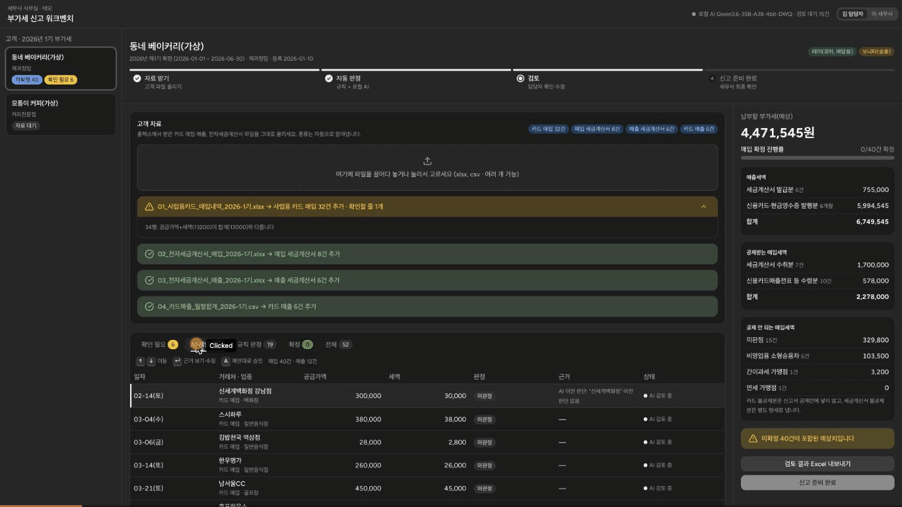

# 부가세 신고 워크벤치 (vat-workbench)

세무사가 **고객이 보낸 파일을 그대로 올리면**, 규칙과 로컬 LLM Agent가 매입세액 공제·불공제를 근거와 함께 제안하고,
**담당자가 확인·확정하면 신고서 요약이 실시간으로 완성되는** 업무 도구입니다.

> 공개 채용공고에 적힌 "업무 흐름·권한·Excel 산출물·세법 규칙을 먼저 모델링하고 그 위에 Agent와 사람 승인을 얹는 세무 플랫폼"을
> 제 방식으로 해석해 작게 직접 만들어 본 개인 프로젝트입니다. 특정 회사의 제품이 아니며, 데이터는 모두 가상입니다.



## 세무사 화면에서 하는 일

1. **고객 파일 한 번에 올리기** — 홈택스에서 받은 카드 매입·매출, 전자세금계산서(매입·매출) 파일을 끌어다 놓으면 헤더로 종류를 알아냅니다.
   잘못된 줄은 "34행: 공급가액+세액이 합계와 다릅니다"처럼 알려 주고, 같은 파일을 다시 올려도 중복으로 들어가지 않습니다.
2. **확실한 건은 규칙이 바로 판정** — 면세·간이 가맹점, 사업자등록 전 매입(과세기간 종료 후 20일 이내 등록 단서 포함),
   차량 유지비는 고객 보유 차량(경차·승용차)을 보고 판정합니다.
3. **애매한 건은 로컬 AI가 근거와 함께 제안** — 거래 조회 → 고객 정보 → 이전 사람 판단 → 결제 내역 → 조문 검색을 거쳐
   "기업업무추진비 가능성, 제39조 제1항 제6호, 직원 회식이면 공제 — 확인 필요"처럼 제안합니다. 진행 단계가 화면에 실시간으로 보입니다.
4. **사람이 확정** — 키보드(↑↓ 이동, Enter 근거 보기, A 승인)로 빠르게 승인하거나 고칩니다. 같은 가맹점 일괄 적용,
   두 사람이 동시에 고치면 늦은 쪽에 알려 줍니다(버전 충돌 409).
5. **신고서 요약이 실시간 갱신** — 매출세액 − 공제 매입세액 = 납부세액, 불공제 사유별 합계. 다른 담당자 화면에도 바로 반영됩니다.
6. **Excel 왕복** — 검토 결과를 내보내 고객에게 확인받고, 고친 파일을 다시 올리면 **바뀐 판정만** 보여 준 뒤 확인하고 반영합니다.
7. **판단 기억** — 확정한 판단은 같은 고객의 다음 신고 때 같은 가맹점에 AI 호출 없이 먼저 제안됩니다.
8. **은행 거래내역·카드사 명세서** — 회사마다 열 이름이 달라서, 처음 보는 형식은 바로 넣지 않고
   "이 열이 날짜, 이 열이 출금액"이라는 추측(열 이름 사전 → 못 찾으면 로컬 AI)과 미리보기를 보여 줍니다.
   담당자가 확인하면 그 형식을 저장해 다음 파일부터는 묻지 않습니다. 원본 몇 번째 줄인지도 남깁니다.
9. **대사(같은 돈이 두 번 잡히지 않게)** — 자료를 함께 보고 자동으로 묶습니다.
   - 카드사 명세서 줄 ↔ 홈택스 사업용카드 내역(같은 날짜·합계): 한 번만 반영
   - 계좌의 카드대금 출금: 개별 사용 내역은 카드 자료로 반영되므로 따로 잡지 않음
   - 계좌 출금 ↔ 받은 세금계산서(합계·거래처 이름·날짜 범위, 매달 같은 임대료는 가장 가까운 달끼리)
   - 남은 계좌 출금은 "증빙 요청 / 세금·보험료·인건비 / 개인 지출"로 나누고, 증빙 요청 목록은 Excel 시트로 고객에게 보냅니다.
     계좌이체만으로는 공제로 확정할 수 없게 막아 두었습니다. 잘못 묶였으면 "같은 거래 아님"으로 풀 수 있습니다.

## 설계에서 지킨 경계

| 누가 | 무엇을 |
|---|---|
| 규칙 | 법·자료로 확실한 것만 판정 |
| AI(Agent) | 초안과 제안까지. **확정 도구는 Agent에게 주지 않음**, Agent도 `agent:qwen` 사용자로 감사이력에 남음 |
| 사람 | 최종 판단. 신고 준비 완료는 검토 세무사만 |
| 시스템 | AI가 느리거나 실패하면 그 건만 "확인 필요"로 넘기고 **업무는 계속** |

## Agent 엔진: Cline식 자율 루프

[Cline](https://github.com/cline/cline)(Apache-2.0)의 루프 구조를 참고해 TypeScript로 새로 구현했습니다(`src/agent/loop.ts`).

- 모델이 매 턴 Tool 하나를 XML 태그로 고름 → 코드가 **Zod로 인수 검증** 후 실행 → 결과를 다음 턴에 돌려줌 → `attempt_completion`으로 끝
- 형식이 틀리면 실행하지 않고 오류를 돌려줘 **스스로 고치게** 함, 최대 턴 수 제한
- Tool은 전부 읽기 전용(`src/agent/tools.ts`): 거래 조회, 고객 정보, 이전 사람 판단, 결제 내역, 조문 검색(데모용 RAG)
- 모델: 이 맥북(M1 Max 64GB)의 **로컬 Qwen3.6-35B-A3B(MLX 4bit)**, 외부 API 없음. 실측 16건 116초(건당 약 7초)

## 기술 스택

- **백엔드**: NestJS + Fastify, MikroORM + PostgreSQL, Zod, **GraphQL(Mercurius) + REST**
  - 조회·판정·실시간 구독은 GraphQL, 파일 업로드·내보내기는 REST. 두 쪽이 **같은 Zod 검증·같은 권한 함수**를 씀
  - 사람·규칙·AI 모든 변경은 append-only 감사이력(`audit_log`)
- **화면**: React 19 + [Astryx](https://github.com/meta/astryx)(Meta 공개 디자인 시스템) + TanStack Query, graphql-ws 구독
- **테스트**: Vitest + 실제 PostgreSQL 통합 테스트 21건(시나리오 LLM 주입: 형식 오류 복구, 타임아웃 시 업무 계속 포함)

## 실행

```bash
brew install node postgresql@16
npm install && npm --prefix web install
npm run db:start        # .pgdata에 PostgreSQL(5433)
npm run llm:start       # 로컬 Qwen(mlx_lm.server, 8080) — 없어도 규칙·사람 검토로 동작
npm run build && npm start   # http://localhost:3000
npm test                # 통합 테스트
npm run samples         # 시연용 가상 파일 6개(은행·카드사 포함) → samples/
npm run demo:reset      # 시연 데이터 초기화
```

화면 오른쪽 위에서 **김 담당자 / 이 세무사**를 바꿔 권한 차이를 볼 수 있습니다. 창 두 개를 띄우면 실시간 반영이 보입니다.

## 한계 (정직하게)

- 세법 판단은 **데모용 단순화**입니다. 조문 요약(`src/rules/law.ts`)은 실제 신고 근거로 쓰면 안 됩니다.
- 예정고지·가산세·의제매입세액·공통매입세액 안분 등은 다루지 않습니다.
- PDF 명세서(글자 있는 PDF → 표 추출, 스캔본 → OCR)는 다음 단계입니다. 지금은 xlsx·csv만 받습니다.
- 카드사 명세서에는 세액이 없어 합계의 1/11로 추정합니다(화면에 ≈ 표시, 간이·면세 확인 안내).
- 인증은 데모용 헤더(`x-user-id`, `x-role`)입니다. 실제라면 SSO 토큰에서 같은 Actor를 만들면 됩니다.
- 다음 단계: Tool 정의를 MCP 서버로 노출, 정답 라벨 평가 세트로 모델 비교, CI 품질 게이트.
